# Project Fact Sheet: AI-ENUMERATOR ASSISTANT
**Final-Year Engineering Project Comprehensive Technical Audit & Fact Sheet**  
*Repository Root:* `d:\AI_Enumerator`  
*Audit Timestamp:* October 2026  

---

## 1. Project Identity

| Attribute | Verified Value from Codebase |
| :--- | :--- |
| **Exact Project Name** | **AI-ENUMERATOR ASSISTANT** (also referenced as `AI-Enumerator Assistant` in [`README.md`](file:///d:/AI_Enumerator/README.md#L1) and `ai-enumerator-backend` in [`backend/pyproject.toml`](file:///d:/AI_Enumerator/backend/pyproject.toml#L2)) |
| **One-Line Purpose** | A mobile and GIS field management platform designed to assist census administration in automated spatial partitioning, satellite-derived building estimation, offline-first household enumeration, authentic GPS geofencing, and route optimization. |
| **Domain** | Geospatial Information Systems (GIS), Cadastral Informatics, Offline-First Mobile Systems, Government Census Operations. |
| **Target Users** | 1. **Deputy Tahsildar** (Sub-district administrative executive responsible for layout generation, spatial boundary review, and final approval).<br>2. **Supervisor** (Field operational officer overseeing layout block distribution, enumerator allocations, and real-time coverage monitoring).<br>3. **Enumerator** (Fieldwork surveyor executing on-the-ground door-to-door household surveys within an assigned block). |
| **Definition of "Enumerator" in this Project** | An authorized ground survey worker assigned strictly to a single **Houselisting Block (HLB)** (target capacity $\approx 250$ structures). The enumerator physically traverses the block using offline maps and route optimization, validates building presence, administers the socio-demographic census questionnaire (via manual touch or offline bilingual voice input in Tamil/English), logs locked houses for revisit, records authentic device GPS pings, and commits records to a local SQLite queue until connectivity permits server synchronization ([`README.md`](file:///d:/AI_Enumerator/README.md#L137-L158), [`mobile/src/features/enumerator/`](file:///d:/AI_Enumerator/mobile/src/features/enumerator/)). |

---

## 2. Tech Stack

### 2.1 Technology Overview

* **Backend Language:** Python `>=3.13` (Active system runtime: **Python 3.13.1**)
* **Backend Framework:** FastAPI `>=0.110.0` (Active: `0.141.1`), Uvicorn `>=0.28.0` (Active: `0.34.0`), Pydantic `>=2.6.4` (Active: `2.10.6`), Pydantic Settings `>=2.2.1`
* **Object-Relational Mapping (ORM) & Spatial Backend:** SQLAlchemy `>=2.0.28` (Active: `2.0.52`), GeoAlchemy2 `>=0.14.7` (Active: `0.17.1`), Psycopg binary `>=3.1.18`, Alembic `>=1.13.1`
* **GIS, Geometry & Spatial Analytics:** Shapely `>=2.0.3` (Active: `2.1.2`), GeoPandas `>=0.14.3` (Active: `1.1.4`), PyProj `3.7.1`, Scikit-learn `>=1.4.1.post1` (Active: `1.9.0`), NumPy `>=2.0` (Active: `2.5.2`), NetworkX `>=3.2.1`
* **Security & Tokens:** PyJWT (`>=2.13.0,<3.0.0`), Bcrypt (`>=5.0.0,<6.0.0`)
* **Mobile Runtime & Language:** Node.js `>=22.11.0`, TypeScript `^6.0.3`
* **Mobile Framework:** React `19.2.3`, React Native `^0.86.3`, Expo SDK `^57.0.18`
* **Mobile Navigation:** `@react-navigation/native` `^7.3.18`, `@react-navigation/native-stack` `^7.18.10`, `react-native-screens` `^4.27.0`, `react-native-safe-area-context` `~5.7.0`
* **Mobile Local Storage & Hardware APIs:** `expo-sqlite` `^57.0.2`, `expo-secure-store` `^57.0.2`, `expo-location` `^57.0.14`, `react-native-maps` `^1.27.2`, `react-native-webview` `13.16.1`
* **Mobile State Management:** Zustand `^5.0.15`
* **Databases:**
  * **Production Target:** PostgreSQL 15/16 + PostGIS 3.3/3.4 (configured via [`docker-compose.yml`](file:///d:/AI_Enumerator/docker-compose.yml#L5) with image `postgis/postgis:15-3.3`).
  * **Development Backend:** SQLite 3.45 (`backend/ai_enumerator.db`, ~1.17 MB cleanly seeded).
  * **Client-Side Offline Storage:** SQLite 3.45 via `expo-sqlite` (`enumerator_fieldwork.db`).
* **LLMs / GenAI APIs:** **NOT FOUND** (No OpenAI, Claude, Gemini, HuggingFace, or LangChain APIs are used in the codebase).
* **Vector Stores:** **NOT FOUND** (No Chroma, FAISS, Pinecone, or pgvector instances exist).
* **Deployment & Tunneling Tools:** Docker Compose (`docker-compose.yml`), `tools/cloudflared.exe` (Cloudflare Tunnel), `tools/ngrok.exe` (Ngrok Tunnel), `@expo/ngrok` `^4.1.3`, `localtunnel` `^2.0.2`.

### 2.2 Complete Dependency Table

#### Backend Dependencies ([`backend/pyproject.toml`](file:///d:/AI_Enumerator/backend/pyproject.toml))
| Package Name | Specified Version Range | Primary Purpose / Role |
| :--- | :--- | :--- |
| `python` | `>=3.13` | Core programming language runtime |
| `fastapi` | `>=0.110.0` | Asynchronous REST API web framework |
| `uvicorn[standard]` | `>=0.28.0` | High-performance ASGI server |
| `sqlalchemy` | `>=2.0.28` | SQL ORM & query builder |
| `psycopg[binary]` | `>=3.1.18` | PostgreSQL / PostGIS database driver |
| `alembic` | `>=1.13.1` | Relational database schema migrations |
| `pydantic` | `>=2.6.4` | Data parsing, validation, and schema definitions |
| `pydantic-settings` | `>=2.2.1` | Environment variable and configuration management |
| `geoalchemy2` | `>=0.14.7` | PostGIS spatial extensions for SQLAlchemy |
| `shapely` | `>=2.0.3` | Geometric operations (buffer, union, intersection) |
| `geopandas` | `>=0.14.3` | Spatial dataframe manipulations |
| `networkx` | `>=3.2.1` | Graph algorithms and network routing structures |
| `scikit-learn` | `>=1.4.1.post1` | Spatial clustering and centroid analytics |
| `pyjwt` | `>=2.13.0,<3.0.0` | JWT bearer token encoding and decoding |
| `bcrypt` | `>=5.0.0,<6.0.0` | Password hashing algorithm |
| `pytest` *(dev)* | `>=8.1.1` | Automated test suite execution |
| `pytest-asyncio` *(dev)* | `>=0.23.5` | Asynchronous test execution runner |
| `httpx` *(dev)* | `>=0.27.0` | Async HTTP client for endpoint testing |
| `ruff` *(dev)* | `>=0.3.3` | Fast linter and code formatter |
| `mypy` *(dev)* | `>=1.9.0` | Static type checker |

#### Mobile Dependencies ([`mobile/package.json`](file:///d:/AI_Enumerator/mobile/package.json))
| Package Name | Specified Version | Primary Purpose / Role |
| :--- | :--- | :--- |
| `react` | `19.2.3` | Core UI component library |
| `react-native` | `^0.86.3` | Cross-platform native mobile application framework |
| `expo` | `^57.0.18` | Expo application framework and managed workflow tools |
| `@react-navigation/native` | `^7.3.18` | Navigation container and routing framework |
| `@react-navigation/native-stack`| `^7.18.10` | Native stack navigation transitions |
| `expo-sqlite` | `^57.0.2` | Local relational database for offline-first fieldwork |
| `expo-secure-store` | `^57.0.2` | Hardware-backed encrypted storage for JWT tokens |
| `expo-location` | `^57.0.14` | Device GPS observation and coordinate tracking |
| `react-native-maps` | `^1.27.2` | Native map canvas and boundary rendering |
| `react-native-screens` | `^4.27.0` | Native screen memory management for navigation |
| `react-native-safe-area-context`| `~5.7.0` | Handling screen notches and safe boundaries |
| `react-native-webview` | `13.16.1` | Web canvas rendering |
| `zustand` | `^5.0.15` | Global lightweight reactive client state management |
| `expo-constants` | `~57.0.16` | Reading runtime manifest, host URI, and build info |
| `jest` *(dev)* | `^29.6.3` | JavaScript/TypeScript unit test framework |
| `jest-expo` *(dev)* | `^57.0.5` | Jest preset for Expo environments |
| `@testing-library/react-native` | `^14.0.1` | Component UI testing utilities |
| `typescript` *(dev)* | `^6.0.3` | Static typing compiler |
| `vite` *(dev)* | `^8.2.2` | Web bundler for browser preview |

---

## 3. System Architecture

### 3.1 Layers, Modules & Roles

1. **Client Layer (Mobile Application):**
   * Built on **React Native (Expo SDK 57)** with role-based navigation guards ([`mobile/src/navigation/AppNavigator.tsx`](file:///d:/AI_Enumerator/mobile/src/navigation/AppNavigator.tsx)).
   * **Local Storage & Sync Engine:** Maintains `offline_hlbs`, `offline_buildings`, `offline_household_records`, and `sync_queue` in an offline-first SQLite database ([`mobile/src/core/sqlite/database.ts`](file:///d:/AI_Enumerator/mobile/src/core/sqlite/database.ts)).
   * **Bilingual Voice Engine:** Rule-based offline extraction engine ([`mobile/src/core/voice/voiceExtractionEngine.ts`](file:///d:/AI_Enumerator/mobile/src/core/voice/voiceExtractionEngine.ts)) supporting Tamil and English demographic parsing.
   * **GPS Auditing:** Authentic hardware location ingestion via `expo-location` ([`mobile/src/core/gpsService.ts`](file:///d:/AI_Enumerator/mobile/src/core/gpsService.ts)).
2. **REST API Gateway Layer (FastAPI Backend):**
   * Central entry point in [`backend/app/main.py`](file:///d:/AI_Enumerator/backend/app/main.py) with top-level aggregation in [`backend/app/api/router.py`](file:///d:/AI_Enumerator/backend/app/api/router.py).
   * Enforces Role-Based Access Control (RBAC) via dependency injection ([`backend/app/api/deps.py`](file:///d:/AI_Enumerator/backend/app/api/deps.py)) using three authoritative roles: `DEPUTY_TAHSILDAR`, `SUPERVISOR`, and `ENUMERATOR`.
3. **GIS & Spatial Optimization Engine:**
   * **Building Ingestion & Detection:** Modular source adapter ([`backend/app/gis/building_sources/open_buildings.py`](file:///d:/AI_Enumerator/backend/app/gis/building_sources/open_buildings.py)) parsing real building footprints from Google Open Buildings V3 with spatial containment filtering.
   * **HLB Spatial Partitioning:** Recursive principal-axis spatial bisection ([`backend/app/gis/hlb/clustering.py`](file:///d:/AI_Enumerator/backend/app/gis/hlb/clustering.py)) coupled with boundary compactness refinement.
   * **Morphological Boundary Builder:** Buffering and alpha-closing pipeline ([`backend/app/gis/hlb/boundary_builder.py`](file:///d:/AI_Enumerator/backend/app/gis/hlb/boundary_builder.py)) synthesizing regularized polygon boundaries from structure points.
   * **Intra-HLB Route Optimizer:** Traveling Salesperson Problem (TSP) solver combining Haversine distance matrix, greedy Nearest Neighbor, and 2-Opt local search ([`backend/app/gis/route/optimizer.py`](file:///d:/AI_Enumerator/backend/app/gis/route/optimizer.py)).
   * **Boundary Uncertainty Auditor:** Geodesic point-in-polygon ray casting with GPS accuracy tolerance buffer checking ([`backend/app/gis/hlb/boundary_checker.py`](file:///d:/AI_Enumerator/backend/app/gis/hlb/boundary_checker.py)).
4. **Persistence & Data Layer:**
   * PostgreSQL 15/16 + PostGIS 3.3/3.4 database models ([`backend/app/models/`](file:///d:/AI_Enumerator/backend/app/models/)), storing spatial polygons in `EPSG:4326` (WGS84) and handling transactional idempotency via `SyncOperation` records.

### 3.2 End-to-End Step-by-Step Data Flow

```text
[Step 1: Administrative Setup]
Deputy Tahsildar selects Village/Ward (e.g., Arasur Village)
       ↓
[Step 2: Satellite Ingestion]
BuildingDetectionService loads satellite footprints (Open Buildings V3 JSON)
Clipped to Village MultiPolygon → Assigns persistent references (BLD-001)
       ↓
[Step 3: Algorithmic Partitioning]
Deputy inputs Target Capacity T = 250 → Spatial Bisection cuts point cloud
Morphological closing (+39m / -17m) generates candidate HLB polygon boundaries
Multi-factor Quality Scorer validates invariants (100% coverage, 0 duplicates)
       ↓
[Step 4: Human-in-the-Loop Supervisory Review]
Deputy inspects HLBs on interactive map → Splits/Merges/Redraws boundary if needed
Deputy Approves Layout → Mutation logged in audit_logs table
       ↓
[Step 5: Operational Hierarchy Allocation]
Deputy assigns Layout to Supervisor → Supervisor assigns exactly 1 Enumerator per HLB
       ↓
[Step 6: Offline Mobile Download]
Enumerator logs into mobile app → Fetches assigned HLB + building coordinates
Persisted into mobile expo-sqlite (offline_hlbs, offline_buildings)
       ↓
[Step 7: Route Guidance & Survey Execution]
TSP solver optimizes visitation order (Nearest-Neighbor + 2-Opt)
Enumerator visits house → Captures device GPS ping (expo-location)
Surveys household via UI form or Tamil/English Voice Assistant
       ↓
[Step 8: Local Transaction & Sync Queue]
Record saved to offline_household_records → Enqueued in sync_queue with UUID idempotency key
       ↓
[Step 9: Resilient Batch Synchronization]
Connectivity detected → Mobile flushes batch POST /api/v1/sync
Server checks idempotency_key, validates HLB ownership, executes atomic DB commit
Returns HTTP 200 → Client transitions queue record to SYNCED
       ↓
[Step 10: Supervisory Progress Auditing]
Supervisor & Deputy dashboards query real-time aggregated metrics
(Completed count, locked houses, revisits, GPS coverage %, geofence compliance)
```

### 3.3 Architecture Mermaid Diagram

```mermaid
graph TB
    subgraph ClientLayer ["Mobile Client (React Native / Expo SDK 57)"]
        subgraph MobileNav ["Role-Based Navigation"]
            AuthNav["AuthNavigator (LoginScreen)"]
            DepNav["DeputyNavigator (HlbReviewScreen, LayoutList)"]
            SupNav["SupervisorNavigator (SupervisorDashboard)"]
            EnumNav["EnumeratorNavigator (HlbDetail, BuildingDetail, HouseholdForm)"]
        end

        subgraph MobileCore ["Core Field Engine"]
            VoiceEng["Offline Voice Engine (Tamil / English)"]
            GpsEng["GPS Service (expo-location)"]
            RouteClient["Route Optimizer Client"]
            SyncClient["Sync Service & Batch Manager"]
        end

        subgraph LocalStore ["Local-First Persistence (expo-sqlite)"]
            SqliteDB[("enumerator_fieldwork.db")]
            T_HLB["offline_hlbs"]
            T_BLD["offline_buildings"]
            T_HH["offline_household_records"]
            T_QUEUE["sync_queue (FIFO Idempotent)"]
            SqliteDB --- T_HLB
            SqliteDB --- T_BLD
            SqliteDB --- T_HH
            SqliteDB --- T_QUEUE
        end

        SecureStore["expo-secure-store (Encrypted JWT)"]
    end

    subgraph ServerLayer ["Backend API Gateway (FastAPI / Python 3.13)"]
        Router["API Router (/api/v1)"]
        AuthMid["RBAC & Security (PyJWT, Bcrypt)"]
        SyncEndpoint["POST /sync (Idempotent Batch Handler)"]
        GpsEndpoint["POST /enumerator/gps (Boundary Audit)"]
        LayoutEndpoint["POST /layouts & /hlbs (Lifecycle & Review)"]
        DashEndpoint["GET /supervisor & /deputy (Aggregated Progress)"]
    end

    subgraph GISEngine ["GIS & Computational Engine"]
        BuildDetect["Building Detection & Ingestion Service"]
        OpenBldSrc["Google Open Buildings V3 Adapter"]
        PartitionEng["Principal-Axis Spatial Bisection (clustering.py)"]
        BoundaryBuild["Morphological Closing Builder (boundary_builder.py)"]
        TspOpt["TSP Solver: Haversine + NN + 2-Opt (optimizer.py)"]
        BoundCheck["Ray-Casting Boundary & Uncertainty Auditor"]
        QualityScore["Multi-Factor Quality Scorer (validation.py)"]
    end

    subgraph DataLayer ["Data & Storage Layer"]
        Postgres[("PostgreSQL 15 / PostGIS 3.3")]
        DatasetJSON["arasur_open_buildings_v3.json (238 Structures)"]
        AuditLog["audit_logs (Immutable Administrative Trail)"]
    end

    %% Interactions
    EnumNav --> LocalStore
    EnumNav --> VoiceEng
    EnumNav --> GpsEng
    SyncClient --> LocalStore
    SyncClient --"HTTPS JSON Batch (Offline Reconnect)"--> SyncEndpoint
    AuthNav --"Credentials"--> AuthMid
    DepNav --"Spatial Edits"--> LayoutEndpoint
    SupNav --"Progress Queries"--> DashEndpoint

    Router --> AuthMid
    Router --> SyncEndpoint
    Router --> GpsEndpoint
    Router --> LayoutEndpoint
    Router --> DashEndpoint

    LayoutEndpoint --> PartitionEng
    LayoutEndpoint --> BoundaryBuild
    LayoutEndpoint --> QualityScore
    LayoutEndpoint --> BuildDetect
    BuildDetect --> OpenBldSrc
    OpenBldSrc --> DatasetJSON

    GpsEndpoint --> BoundCheck
    Router --> TspOpt

    SyncEndpoint --> Postgres
    LayoutEndpoint --> Postgres
    LayoutEndpoint --> AuditLog
    DashEndpoint --> Postgres
```



---

## 4. Features

| Feature Name | Status | Primary Implementation File(s) | Description |
| :--- | :---: | :--- | :--- |
| **JWT Authentication & RBAC** | **Implemented** | [`backend/app/api/endpoints/auth.py`](file:///d:/AI_Enumerator/backend/app/api/endpoints/auth.py), [`app/services/auth_service.py`](file:///d:/AI_Enumerator/backend/app/services/auth_service.py), [`mobile/src/features/authentication/LoginScreen.tsx`](file:///d:/AI_Enumerator/mobile/src/features/authentication/LoginScreen.tsx) | OAuth2 password flow issuing JWTs with role redirection (`DEPUTY_TAHSILDAR`, `SUPERVISOR`, `ENUMERATOR`). |
| **Administrative Boundary Management** | **Implemented** | [`backend/app/api/endpoints/areas.py`](file:///d:/AI_Enumerator/backend/app/api/endpoints/areas.py), [`app/models/administrative_area.py`](file:///d:/AI_Enumerator/backend/app/models/administrative_area.py) | Stores and retrieves cadastral village/ward MultiPolygons in EPSG:4326. |
| **Satellite Building Footprint Estimation** | **Implemented** | [`backend/app/gis/building_detection.py`](file:///d:/AI_Enumerator/backend/app/gis/building_detection.py), [`app/gis/building_sources/open_buildings.py`](file:///d:/AI_Enumerator/backend/app/gis/building_sources/open_buildings.py) | Ingests real building footprints, calculates geodesic areas, confidence filters, and density clusters. |
| **Raw Satellite Tile CNN Detection** | **PLANNED / PARTIAL** | [`backend/app/ai/__init__.py`](file:///d:/AI_Enumerator/backend/app/ai/__init__.py) | Direct neural network inference on raw satellite image rasters is stubbed; the directory contains an empty `__init__.py`. Ingestion currently uses pre-extracted Open Buildings V3 polygons and development synthetic fallbacks. |
| **Recursive Spatial Bisection Partitioning** | **Implemented** | [`backend/app/gis/hlb/clustering.py`](file:///d:/AI_Enumerator/backend/app/gis/hlb/clustering.py) | Partitions $N$ structures into $K$ blocks along the principal spatial covariance axis with exact building count parity ($\sigma=0.00$). |
| **Boundary Compactness Refinement** | **Implemented** | [`backend/app/gis/hlb/clustering.py`](file:///d:/AI_Enumerator/backend/app/gis/hlb/clustering.py#L88-L137) | Iterative pairwise frontier point swapping between adjacent clusters to minimize spatial dispersion while preserving cardinality. |
| **Morphological Boundary Synthesis** | **Implemented** | [`backend/app/gis/hlb/boundary_builder.py`](file:///d:/AI_Enumerator/backend/app/gis/hlb/boundary_builder.py) | Point buffer aggregation and morphological closing ($+0.00035^\circ / -0.00015^\circ$) clipped to village limits. |
| **Multi-Factor Quality Scoring** | **Implemented** | [`backend/app/gis/hlb/validation.py`](file:///d:/AI_Enumerator/backend/app/gis/hlb/validation.py) | Computes composite quality score $Q$ across count balance ($0.40$), continuity ($0.30$), boundary containment ($0.20$), and compactness ($0.10$). |
| **Supervisory HLB Spatial Editing** | **Implemented** | [`backend/app/gis/hlb/editing_service.py`](file:///d:/AI_Enumerator/backend/app/gis/hlb/editing_service.py), [`backend/app/api/endpoints/hlbs.py`](file:///d:/AI_Enumerator/backend/app/api/endpoints/hlbs.py) | Server-side split (balanced/ratio/draw-line), merge of adjacent blocks, boundary vertex redraw, and structure transfer with invariant validation. |
| **Immutable Administrative Audit Trail** | **Implemented** | [`backend/app/models/audit_log.py`](file:///d:/AI_Enumerator/backend/app/models/audit_log.py) | Captures pre- and post-mutation JSON state snapshots for layout approvals, block splits, and block merges. |
| **Supervisor-to-Layout Assignment** | **Implemented** | [`backend/app/api/endpoints/supervisors.py`](file:///d:/AI_Enumerator/backend/app/api/endpoints/supervisors.py), [`app/services/supervisor_service.py`](file:///d:/AI_Enumerator/backend/app/services/supervisor_service.py) | Assigns approved layouts to supervisors with status verification. |
| **Enumerator-to-HLB 1:1 Assignment** | **Implemented** | [`backend/app/api/endpoints/enumerators.py`](file:///d:/AI_Enumerator/backend/app/api/endpoints/enumerators.py), [`app/services/enumerator_service.py`](file:///d:/AI_Enumerator/backend/app/services/enumerator_service.py) | Enforces strict rule: 1 HLB is assigned to exactly 1 primary enumerator. Prevents duplicate active assignments. |
| **Offline-First SQLite Storage** | **Implemented** | [`mobile/src/core/sqlite/database.ts`](file:///d:/AI_Enumerator/mobile/src/core/sqlite/database.ts), [`offlineRepositories.ts`](file:///d:/AI_Enumerator/mobile/src/core/sqlite/offlineRepositories.ts) | Complete local relational database storing HLB metadata, buildings, household census forms, revisit records, and GPS logs. |
| **Idempotent Sync Queue Engine** | **Implemented** | [`mobile/src/core/sqlite/syncQueueRepository.ts`](file:///d:/AI_Enumerator/mobile/src/core/sqlite/syncQueueRepository.ts), [`backend/app/services/sync_service.py`](file:///d:/AI_Enumerator/backend/app/services/sync_service.py) | Client FIFO queue tracking state (`PENDING`, `SYNCING`, `SYNCED`, `FAILED`, `CONFLICT`) using UUID idempotency keys to prevent duplicate records. |
| **Authentic GPS Boundary Auditing** | **Implemented** | [`backend/app/gis/hlb/boundary_checker.py`](file:///d:/AI_Enumerator/backend/app/gis/hlb/boundary_checker.py), [`mobile/src/core/gpsService.ts`](file:///d:/AI_Enumerator/mobile/src/core/gpsService.ts) | Ingests real coordinates from `expo-location`, flags outside status non-destructively, and calculates `BOUNDARY_UNCERTAIN` when $D \le R_{\text{gps}}$. |
| **Intra-HLB Route Optimization (TSP)**| **Implemented** | [`backend/app/gis/route/optimizer.py`](file:///d:/AI_Enumerator/backend/app/gis/route/optimizer.py), [`backend/app/api/endpoints/route.py`](file:///d:/AI_Enumerator/backend/app/api/endpoints/route.py), [`mobile/src/core/routeService.ts`](file:///d:/AI_Enumerator/mobile/src/core/routeService.ts) | Haversine distance matrix + Nearest-Neighbor + 2-Opt local search TSP solver generating monotonic path distance reductions. |
| **Offline Bilingual Voice Assistant** | **Implemented** | [`mobile/src/core/voice/voiceExtractionEngine.ts`](file:///d:/AI_Enumerator/mobile/src/core/voice/voiceExtractionEngine.ts), [`offlineVoiceService.ts`](file:///d:/AI_Enumerator/mobile/src/core/voice/offlineVoiceService.ts), [`mobile/src/components/VoiceAssistantModal.tsx`](file:///d:/AI_Enumerator/mobile/src/components/VoiceAssistantModal.tsx) | Rule-based demographic extraction from spoken Tamil and English text, validating member counts and gender sums with human confirmation. |
| **On-Device Neural ASR (Whisper)** | **PLANNED / PARTIAL** | [`mobile/src/core/voice/offlineVoiceService.ts`](file:///d:/AI_Enumerator/mobile/src/core/voice/offlineVoiceService.ts#L80-L86) | Speech-to-text relies on platform speech recognition or simulated text transcripts; an embedded neural acoustic model (e.g., Whisper.tflite) is not packaged locally. |
| **Supervisor Progress Dashboard** | **Implemented** | [`backend/app/api/endpoints/supervisors.py`](file:///d:/AI_Enumerator/backend/app/api/endpoints/supervisors.py), [`mobile/src/features/supervisor/SupervisorDashboardScreen.tsx`](file:///d:/AI_Enumerator/mobile/src/features/supervisor/SupervisorDashboardScreen.tsx) | Aggregates layout progress %, completed vs. remaining houses, locked house counts, and last synchronization timestamps. |
| **Deputy Progress Monitoring** | **Implemented** | [`backend/app/api/endpoints/deputy.py`](file:///d:/AI_Enumerator/backend/app/api/endpoints/deputy.py), [`mobile/src/features/deputy/DeputyDashboardScreen.tsx`](file:///d:/AI_Enumerator/mobile/src/features/deputy/DeputyDashboardScreen.tsx) | Multi-layout sub-district overview calculating macro completion percentages without exposing individual citizen PII. |
| **Production APK Release Build** | **PLANNED / PARTIAL** | [`mobile/android/`](file:///d:/AI_Enumerator/mobile/android/) | Native Android project files and Gradle configs exist, but no compiled `.apk` or `.aab` binary is stored in the repository. |

---

## 5. AI/ML Details

* **Models Used:**
  * **Pre-trained Building Footprint Dataset:** Google Open Buildings V3 dataset ([`backend/app/data/open_buildings/arasur_open_buildings_v3.json`](file:///d:/AI_Enumerator/backend/app/data/open_buildings/arasur_open_buildings_v3.json)), containing polygon coordinates, centroid points, and confidence scores derived from high-resolution satellite imagery.
  * **Deep Learning Computer Vision Models:** **NOT FOUND** (No PyTorch `.pt`, TensorFlow `.pb`, or ONNX model files are in the repository).
  * **Large Language Models (LLMs):** **NOT FOUND** (No generative AI models or LLM API keys are used).
* **Prompts or Prompt Templates:** **NOT FOUND** (The application does not use prompting).
* **RAG / Embedding Setup:** **NOT FOUND** (No document chunking, embeddings, or vector databases).
* **Tools / Function Calls / Agent Loops:** **NOT FOUND** (The software uses deterministic algorithmic pipelines and finite state machines rather than agentic LLM loops).
* **Natural Language Processing (NLP) Setup:**
  * **Mechanism:** Pure rule-based parsing engine written in TypeScript ([`mobile/src/core/voice/voiceExtractionEngine.ts`](file:///d:/AI_Enumerator/mobile/src/core/voice/voiceExtractionEngine.ts)).
  * **Dictionaries:** Tamil number words (`ஒன்று`: 1, `இரண்டு`: 2, `நான்கு`: 4, etc.) and English number words (`one`, `two`, `three`, etc.).
  * **Ambiguity Detection:** Detects approximation words (`அல்லது`, `சுமார்`, `around`, `maybe`, `or`) and flags extraction as `UNCERTAIN`.
  * **Arithmetic Validation:** Evaluates $\text{male\_count} + \text{female\_count} + \text{transgender\_count} = \text{total\_members}$. If mismatched, marks status as `NEEDS_REVIEW`.
* **Spatial & Graph Optimization Algorithms:**
  * **Spatial Partitioning:** Principal-Axis Spatial Bisection ($O(N \log N)$) using centroid spatial covariance ($\text{Cov}(\lambda, \phi)$) and projection angle $\theta = 0.5 \cdot \text{atan2}(2\text{Cov}, \text{Var}(\lambda) - \text{Var}(\phi))$, followed by pairwise swap refinement ($O(I \cdot K^2)$).
  * **Intra-HLB Routing:** Traveling Salesperson Problem solver using Haversine metric distance matrix ($O(N^2)$), greedy Nearest Neighbor sequence ($O(N^2)$), and 2-Opt local edge-exchange search ($O(N^2)$ per pass, capped at 100 iterations).
* **Training / Fine-Tuning:** **NONE** (No training routines, weights, or fine-tuning datasets exist in the folder).
* **Configurable Hyperparameters:**
  * Target Block Size: $T = 250$ structures (tolerance band $T \pm 20\% \implies [200, 300]$).
  * Morphological Closing Parameters: Buffer expansion $+0.00035^\circ$ ($\approx 39\text{ m}$), buffer contraction $-0.00015^\circ$ ($\approx 17\text{ m}$).
  * Quality Score Formulation: $\text{QualityScore} = 0.40 \cdot S_{\text{count}} + 0.30 \cdot S_{\text{continuity}} + 0.20 \cdot S_{\text{boundary}} + 0.10 \cdot S_{\text{compactness}}$.
  * GPS Accuracy Tiers: `GOOD` ($\le 25\text{ m}$), `POOR` ($> 25\text{ m}$), `UNKNOWN` ($> 100\text{ m}$).
  * TSP Convergence: Maximum 100 iterations, improvement delta $\epsilon = 10^{-6}$.

---

## 6. Data

* **Datasets Present in Repository:**
  * **Real Dataset:** Google Open Buildings V3 for Arasur Village, Coimbatore, Tamil Nadu, India ([`backend/app/data/open_buildings/arasur_open_buildings_v3.json`](file:///d:/AI_Enumerator/backend/app/data/open_buildings/arasur_open_buildings_v3.json)).
    * **File Size:** 176,018 bytes ($\approx 176\text{ KB}$).
    * **Record Count:** Exactly 238 building structures.
    * **Geographic Extent:** Latitude $[11.0705, 11.0945]$, Longitude $[77.1105, 77.1345]$.
    * **Attributes per Record:** `id`, `latitude`, `longitude`, `area_in_meters`, `confidence` ($0.65$ to $0.89$), `full_plus_code`, and `geometry` (Polygon coordinates).
  * **Synthetic Benchmark Datasets:** Used in [`paper_artifacts/experiments/protocol1_hlb_generation.py`](file:///d:/AI_Enumerator/paper_artifacts/experiments/protocol1_hlb_generation.py) with seeds `42` to `46`:
    * D1 (Small): 250 structures
    * D2 (Medium): 500 structures
    * D3 (Large): 1,000 structures
    * D4 (X-Large): 1,500 structures
    * Scale Stress: 5,000, 10,000, and 25,000 structures
* **Census Forms & Questionnaires:**
  * **Household Socio-Demographic Form** ([`backend/app/models/fieldwork.py`](file:///d:/AI_Enumerator/backend/app/models/fieldwork.py#L67-L140), [`mobile/src/features/enumerator/HouseholdFormScreen.tsx`](file:///d:/AI_Enumerator/mobile/src/features/enumerator/HouseholdFormScreen.tsx)):
    * `household_number`: String (e.g., `"HH-01"`)
    * `head_name`: String (e.g., `"M. Murugan"`)
    * `total_members`: Integer ($\ge 1$)
    * `male_count`: Integer ($\ge 0$)
    * `female_count`: Integer ($\ge 0$)
    * `transgender_count`: Integer ($\ge 0$)
    * `ownership_status`: Enum (`OWNED`, `RENTED`, `OTHER`)
    * `drinking_water_source`: String (`Tap Water`, `Well Water`, `Tube Well`, `Tanker Truck`)
    * `lighting_source`: String (`Electricity`, `Solar`, `Kerosene`)
    * `latrine_facility`: String (`Yes`, `No`)
    * `source`: String (`FORM` or `VOICE`)
  * **Revisit Record Form** ([`backend/app/models/fieldwork.py`](file:///d:/AI_Enumerator/backend/app/models/fieldwork.py#L143-L190)):
    * `building_id`, `reason` (e.g., `"Door Locked"`, `"Respondent Not Available"`), `notes`, `status` (`PENDING`, `RESOLVED`, `CANCELLED`).
* **Preprocessing Pipeline:**
  1. Administrative boundary geometry parsed from GeoJSON and validated via Shapely `make_valid`.
  2. Bounding box pre-filter discards external coordinates.
  3. Exact spatial intersection/containment tests check if structure centroid lies within village envelope.
  4. Stable deterministic building identifier calculated: `BLD-XXX` derived from coordinate hashing.
* **Storage Engines:**
  * Central Server: PostgreSQL 15 + PostGIS (Production) / SQLite (`ai_enumerator.db`).
  * Field Mobile Client: SQLite via `expo-sqlite` (`enumerator_fieldwork.db`).

---

## 7. Key Code Snippets

### 7.1 Recursive Principal-Axis Spatial Bisection
*File:* [`backend/app/gis/hlb/clustering.py`](file:///d:/AI_Enumerator/backend/app/gis/hlb/clustering.py#L38-L67)
```python
def _recursive_spatial_bisect(
    buildings: list[dict[str, Any]], cluster_sizes: list[int]
) -> list[list[dict[str, Any]]]:
    if len(cluster_sizes) == 1:
        return [buildings]
    half = len(cluster_sizes) // 2
    left_target = sum(cluster_sizes[:half])
    
    lats = [b["latitude"] for b in buildings]
    lngs = [b["longitude"] for b in buildings]
    c_lat, c_lng = sum(lats) / len(lats), sum(lngs) / len(lngs)
    
    cov_xy = sum((b["longitude"] - c_lng) * (b["latitude"] - c_lat) for b in buildings)
    var_x = sum((b["longitude"] - c_lng) ** 2 for b in buildings)
    var_y = sum((b["latitude"] - c_lat) ** 2 for b in buildings)
    theta = 0.5 * math.atan2(2 * cov_xy, var_x - var_y)
    u_x, u_y = math.cos(theta), math.sin(theta)
    
    sorted_b = sorted(
        buildings,
        key=lambda b: (b["longitude"] - c_lng) * u_x + (b["latitude"] - c_lat) * u_y,
    )
    return _recursive_spatial_bisect(
        sorted_b[:left_target], cluster_sizes[:half]
    ) + _recursive_spatial_bisect(
        sorted_b[left_target:], cluster_sizes[half:]
    )
```

### 7.2 Morphological Boundary Synthesis
*File:* [`backend/app/gis/hlb/boundary_builder.py`](file:///d:/AI_Enumerator/backend/app/gis/hlb/boundary_builder.py#L34-L58)
```python
# Buffer structures and apply morphological closing to bridge gaps
buffered_geoms = []
for bld in buildings:
    if bld.footprint is not None:
        poly = to_shape(bld.footprint)
        buffered_geoms.append(poly.buffer(0.00025))
    else:
        pt = Point(bld.longitude, bld.latitude)
        buffered_geoms.append(pt.buffer(0.00035))

union_geom = unary_union(buffered_geoms)
# Morphological closing: expand by ~39m, then contract by ~17m
closed_geom = union_geom.buffer(0.00035).buffer(-0.00015)

if layout_boundary_geom is not None:
    closed_geom = closed_geom.intersection(layout_boundary_geom)

if isinstance(geom_poly, Polygon):
    return MultiPolygon([closed_geom])
return closed_geom
```

### 7.3 TSP 2-Opt Edge-Exchange Local Search
*File:* [`backend/app/gis/route/optimizer.py`](file:///d:/AI_Enumerator/backend/app/gis/route/optimizer.py#L52-L78)
```python
def improve_tsp_2opt(
    tour: list[int], dist_matrix: list[list[float]], max_iterations: int = 100
) -> list[int]:
    n = len(tour)
    if n <= 3:
        return tour
    improved = True
    iterations = 0
    best_tour = list(tour)
    while improved and iterations < max_iterations:
        improved = False
        iterations += 1
        for i in range(1, n - 2):
            for j in range(i + 1, n - 1):
                delta = (
                    dist_matrix[best_tour[i - 1]][best_tour[j]]
                    + dist_matrix[best_tour[i]][best_tour[j + 1]]
                ) - (
                    dist_matrix[best_tour[i - 1]][best_tour[i]]
                    + dist_matrix[best_tour[j]][best_tour[j + 1]]
                )
                if delta < -1e-6:
                    best_tour[i : j + 1] = reversed(best_tour[i : j + 1])
                    improved = True
    return best_tour
```

### 7.4 Idempotent Batch Server Synchronization
*File:* [`backend/app/services/sync_service.py`](file:///d:/AI_Enumerator/backend/app/services/sync_service.py#L60-L86)
```python
for item in batch.items:
    existing_op = db.query(SyncOperation).filter(
        SyncOperation.idempotency_key == item.idempotency_key
    ).first()
    if existing_op:
        # Idempotency replay: return prior response without duplicate mutation
        results.append(SyncResultItem(
            idempotency_key=item.idempotency_key,
            status=SyncItemStatus.SUCCESS,
            server_id=existing_op.server_record_id,
            message="Already synced (idempotent replay)"
        ))
        continue

    server_id = self._process_single_sync_item(db, current_user, item)
    sync_op = SyncOperation(
        idempotency_key=item.idempotency_key,
        enumerator_id=current_user.id,
        operation_type=item.operation_type,
        entity_type=item.entity_type,
        server_record_id=server_id
    )
    db.add(sync_op)
    results.append(SyncResultItem(
        idempotency_key=item.idempotency_key,
        status=SyncItemStatus.SUCCESS,
        server_id=server_id
    ))
db.commit()
```

### 7.5 Bilingual Demographic Field Parsing Rule
*File:* [`mobile/src/core/voice/voiceExtractionEngine.ts`](file:///d:/AI_Enumerator/mobile/src/core/voice/voiceExtractionEngine.ts#L529-L547)
```python
// TypeScript / React Native engine
if (totalMembers && totalMembers.value !== null && (maleCount || femaleCount || transgenderCount)) {
  const male = maleCount?.value || 0;
  const female = femaleCount?.value || 0;
  const trans = transgenderCount?.value || 0;
  const sum = male + female + trans;

  if (maleCount && femaleCount && sum !== totalMembers.value) {
    isArithmeticMismatch = true;
    totalMembers.confidence = 'UNCERTAIN';
    totalMembers.reason = `Gender breakdown sum (${sum}) does not match total members count (${totalMembers.value}).`;
  }
}
```

---

## 8. User Interface

### 8.1 UI Framework & Routes
* **Framework:** React Native (Expo SDK 57), TypeScript, React Navigation Native Stack v7.
* **Navigation Architecture:** Role-switched navigators managed by [`mobile/src/navigation/AppNavigator.tsx`](file:///d:/AI_Enumerator/mobile/src/navigation/AppNavigator.tsx).

#### Screen Inventory by Role
1. **Authentication Flow:**
   * `LoginScreen`: Username, password, role picker, API endpoint config ([`mobile/src/features/authentication/LoginScreen.tsx`](file:///d:/AI_Enumerator/mobile/src/features/authentication/LoginScreen.tsx)).
2. **Deputy Tahsildar Navigator (`DeputyNavigator.tsx`):**
   * `DeputyDashboardScreen`: Sub-district area summary, active layout statuses.
   * `AreaListScreen`: List of revenue villages/wards.
   * `AreaMapScreen`: Village boundary canvas overlaid on satellite imagery.
   * `LayoutListScreen`: Layout versions, creation timestamps, and statuses.
   * `HlbGenerationScreen`: Target capacity entry ($T=250$) and generation trigger.
   * `HlbReviewScreen`: Interactive block map, quality score badges, split/merge/redraw controls.
   * `DeputyLayoutDetailScreen`: Detailed block metrics, supervisor allocation modal.
3. **Supervisor Navigator (`SupervisorNavigator.tsx`):**
   * `SupervisorDashboardScreen`: Allocated layouts, overall completion gauges.
   * `SupervisorLayoutDetailScreen`: List of HLBs within layout, enumerator assignment buttons.
   * `EnumeratorAssignmentModal`: Modal to select and bind an active enumerator to an HLB.
   * `SupervisorHlbDetailModal`: Detailed modal inspecting block progress, locked houses, and GPS compliance.
4. **Enumerator Navigator (`EnumeratorNavigator.tsx`):**
   * `EnumeratorDashboardScreen`: Downloaded HLB card, sync button, GPS toggle.
   * `EnumeratorHlbDetailScreen`: Interactive block map, building marker list, optimized route overlay.
   * `BuildingDetailScreen`: Structure metadata, visit status updater, GPS distance check.
   * `HouseholdFormScreen`: Full census questionnaire form with voice assistant trigger.
   * `VoiceAssistantModal`: Tamil/English voice input modal with audio waveform visualization.

### 8.2 Existing Images in Repository
The folder contains exactly **7 high-resolution research figures** (available in both 300 DPI `.png` and vector `.pdf`) inside [`paper_artifacts/figures/`](file:///d:/AI_Enumerator/paper_artifacts/figures/):
1. `fig1_hlb_partitioning_before_after.png` / `.pdf`: Before/after spatial partitioning map ($N=1000$ building points partitioned into 4 colored polygons).
2. `fig2_baseline_comparison.png` / `.pdf`: Workload standard deviation ($\sigma$) and quality score bar chart comparing Proposed method vs. K-Means, Median Bisect, and Grid.
3. `fig3_runtime_scaling_loglog.png` / `.pdf`: Log-log runtime scaling curve from $N=250$ to $N=25,000$ structures.
4. `fig4_route_optimization_map.png` / `.pdf`: Spatial route map comparing baseline zigzagging tour vs. 2-opt optimized tour.
5. `fig5_sync_resilience_statemachine.png` / `.pdf`: Client-server queue state machine diagram and 50% packet drop convergence time series.
6. `fig6_ablation_study.png` / `.pdf`: Ablation chart evaluating convex hull vs. raw point buffer vs. morphological smoothing.
7. `fig7_mobile_supervisory_ui.png` / `.pdf`: Three-panel UI layout mockup showing supervisory review, field map navigation, and household form.
*(Standard Android launcher mipmap icons also exist in `mobile/android/app/src/main/res/mipmap-*/ic_launcher.png`).*

### 8.3 Recommended Screenshot Capture Checklist (Step-by-Step)

To complete the UI section of the project report, capture actual screenshots of the running Expo application using these exact navigation steps:

* [ ] **Screenshot 1: Role Authentication Screen**  
  *Path to reach:* Launch app $\to$ `LoginScreen`.  
  *What to show:* Username input, password input, role selection dropdown (`Deputy Tahsildar`, `Supervisor`, `Enumerator`), and the `API URL` configuration field.
* [ ] **Screenshot 2: Deputy Tahsildar Spatial Review & HLB Map**  
  *Path to reach:* Log in as `deputy` / `password123` $\to$ Select "Arasur Village" $\to$ Tap "Review Layout" $\to$ `HlbReviewScreen`.  
  *What to show:* Interactive map displaying candidate HLBs in distinct colors, quality score badge (e.g., `VALID (0.85)`), and "Split", "Merge", and "Approve Layout" action buttons.
* [ ] **Screenshot 3: Supervisory Allocation & Field Progress Dashboard**  
  *Path to reach:* Log in as `supervisor` / `password123` $\to$ `SupervisorDashboardScreen` $\to$ Tap "Layout-01".  
  *What to show:* Progress bars (% completed), total vs. remaining buildings, locked count, and the "Assign Enumerator" modal showing HLB-to-Enumerator binding.
* [ ] **Screenshot 4: Enumerator Field Map & Optimized Route Overlay**  
  *Path to reach:* Log in as `enumerator` / `password123` $\to$ Tap "Download HLB" $\to$ Tap "View Map" $\to$ `EnumeratorHlbDetailScreen`.  
  *What to show:* Satellite/street map overlay, ordered polyline showing the 2-Opt TSP route, numbered building markers (Green = Completed, Gray = Pending, Red = Locked), and GPS location dot.
* [ ] **Screenshot 5: Offline Household Survey Form with Voice Assistant**  
  *Path to reach:* From `EnumeratorHlbDetailScreen`, tap building `BLD-001` $\to$ Tap "Start Survey" $\to$ `HouseholdFormScreen` $\to$ Tap the microphone icon.  
  *What to show:* Demographic input fields (Head of Household, Total Members, Gender Breakdown) and the `VoiceAssistantModal` displaying the recognized Tamil text (`"இந்த வீட்டில் நான்கு பேர் இருக்கிறார்கள்"`) and extracted structured fields.

---

## 9. Testing and Results

### 9.1 Test Suites

* **Total Automated Tests in Repository:** **341 tests**
  * **Backend Unit & Integration Tests:** **151 tests** across 15 files in [`backend/tests/`](file:///d:/AI_Enumerator/backend/tests/) (all passing in 0.76s via pytest).
  * **Mobile Component & Flow Tests:** **190 tests** across 19 suites in [`mobile/__tests__/`](file:///d:/AI_Enumerator/mobile/__tests__/) (executed via Jest).

| Test Suite / Protocol File | Target Component | Verified Test Count / Metric |
| :--- | :--- | :---: |
| `backend/tests/test_hlb_generation.py` | Spatial Bisection, Invariant Checks | 8 tests |
| `backend/tests/test_hlb_editing.py` | Split, Merge, Redraw, Transfer APIs | 10 tests |
| `backend/tests/test_route.py` | Haversine, Distance Matrix, 2-Opt TSP | 11 tests |
| `backend/tests/test_sync.py` | Sync Queue, Idempotency Replay, Auth | 8 tests |
| `backend/tests/test_gps.py` | Ray Casting, Uncertainty Buffer | 7 tests |
| `backend/tests/test_supervisor_progress.py`| Supervisor Aggregation & RBAC | 20 tests |
| `backend/tests/test_deputy_progress.py` | Macro Multi-Layout Aggregation | 21 tests |
| `mobile/__tests__/OfflineVoiceAssistant.test.tsx` | Tamil/English Voice NLP Extraction | 18 tests |
| `mobile/__tests__/GpsBoundaryMonitoring.test.tsx`| Mobile Geofence & Location Tiers | 12 tests |
| `mobile/__tests__/SyncFlow.test.tsx` | SQLite Queue Transitions & Retries | 14 tests |

### 9.2 Measured Empirical Results

All experimental metrics are recorded from raw benchmark artifacts in [`paper_artifacts/raw/`](file:///d:/AI_Enumerator/paper_artifacts/raw/) and documented in [`paper_artifacts/results_tables.md`](file:///d:/AI_Enumerator/paper_artifacts/results_tables.md).

#### 1. HLB Partitioning Benchmark ($N=1,000$ structures, Target $T=250$, 5 Independent Trials)
| Metric | Proposed Method (Principal Bisect + Refine) | Baseline 1: Standard K-Means ($k=4$) | Baseline 2: Recursive Median Bisection | Baseline 3: Uniform $2\times2$ Grid |
| :--- | :---: | :---: | :---: | :---: |
| **Mean Size ($\mu$)** | **250.00** | 250.00 | 250.00 | 250.00 |
| **Workload Std Dev ($\sigma$)** | **0.00 $\pm$ 0.00** | $81.02 \pm 36.79$ | 0.00 $\pm$ 0.00 | $109.57 \pm 36.72$ |
| **Min / Max Size** | **250 / 250** | 75 / 449 | 250 / 250 | 40 / 460 |
| **% Blocks in Tolerance ($[200, 300]$)**| **100.0%** | 35.0% | 100.0% | 40.0% |
| **Composite Quality Score ($\overline{Q}$)** | **0.8585 $\pm$ 0.0313** | 0.7403 $\pm$ 0.0466 | 0.8524 $\pm$ 0.0344 | 0.7285 $\pm$ 0.0486 |
| **Mean Isoperimetric Quotient (IPQ)**| **0.1525** | 0.1434 | 0.1502 | 0.1286 |
| **Algorithm Runtime (ms)** | **31.26 $\pm$ 10.93** | 645.76 $\pm$ 1043.96 | 6.76 $\pm$ 1.91 | 3.41 $\pm$ 0.73 |

#### 2. Scale Stress Test ($N = 250$ to $25,000$ structures)
* $N = 250$ ($K = 1$ block): Runtime $= 0.01\text{ ms}$, Coverage $= 100\%$, Duplicates $= 0$.
* $N = 1,000$ ($K = 4$ blocks): Runtime $= 22.34\text{ ms}$, Coverage $= 100\%$, Duplicates $= 0$.
* $N = 5,000$ ($K = 20$ blocks): Runtime $= 2,363.74\text{ ms}$ ($2.36\text{ s}$), Coverage $= 100\%$.
* $N = 25,000$ ($K = 100$ blocks): Runtime $= 69,494.84\text{ ms}$ ($69.49\text{ s}$), Coverage $= 100\%$, Duplicates $= 0$.

#### 3. Intra-HLB Route Optimization Performance ($N = 250$ structures)
* **Urban Dense Topology:** Baseline database path $= 88.338\text{ km} \to$ Optimized tour $= \mathbf{7.707\text{ km}}$ (**$91.28\%$ distance reduction**, solver runtime $258.24\text{ ms}$, $0$ cross-block edges).
* **Suburban Grid Topology:** Baseline path $= 20.210\text{ km} \to$ Optimized tour $= \mathbf{9.941\text{ km}}$ (**$50.81\%$ distance reduction**, solver runtime $119.16\text{ ms}$, $0$ cross-block edges).
* **Rural Linear Topology:** Baseline path $= 16.552\text{ km} \to$ Optimized tour $= \mathbf{6.694\text{ km}}$ (**$59.56\%$ distance reduction**, solver runtime $20.42\text{ ms}$).
* **Dispersed Hamlet:** Baseline path $= 386.537\text{ km} \to$ Optimized tour $= \mathbf{27.663\text{ km}}$ (**$92.84\%$ distance reduction**, solver runtime $247.98\text{ ms}$).

#### 4. Offline Sync Engine Resilience (50% Packet Drop Rate, 10 Trials per Batch)
* Batch 25: 100% sync success, latency $0.516\text{ s}$, 0 duplicate insertions, 0 conflicts.
* Batch 100: 100% sync success, latency $2.538\text{ s}$, 0 duplicate insertions, 0 conflicts.
* Batch 250: 100% sync success, latency $6.508\text{ s}$, 0 duplicate insertions, 0 conflicts.
* **Fault Injection Tests:** Mid-sync app crash recovery, duplicate idempotency replay, and 100% offline burst reconnect all passed with **100% data integrity and zero record loss**.

#### 5. Supervisory Simulation & Validation Guardrails
* **Reviewer Interventions Tested:** 9 simulated edits across 3 settlement scenarios.
* **Illegal Edits Injected:** 2 (attempting to merge non-adjacent blocks; redrawing polygon outside village boundary).
* **Illegal Edits Blocked:** **2 / 2 ($100\%$ rejection rate)** via `validate_and_score_hlb` guardrail.
* **Edit Validation Latency:** $47.24 \pm 12.15\text{ ms}$.

---

## 10. Setup and Installation

### 10.1 Environment Requirements
* **Operating System:** Windows 10/11, Ubuntu 22.04+, or macOS.
* **Hardware:** Minimum 8 GB RAM (16 GB recommended for large spatial clustering), x86_64 or Apple Silicon processor.
* **Software:**
  * Python `3.13+` with Poetry (`>=2.0.0`)
  * Node.js `>=22.11.0` with npm
  * Docker Desktop (optional, required if using PostgreSQL/PostGIS container)
  * Expo Go mobile app (on physical Android phone) or Android Studio emulator
* **API Keys Required:** **NONE**. (Uses local datasets, public OpenStreetMap tile layers, and local SQLite/PostGIS database).

### 10.2 Backend Setup & Execution Commands

```bash
# 1. Navigate to backend directory
cd d:\AI_Enumerator\backend

# 2. Install dependencies via Poetry
poetry install

# 3. Configure environment settings (SQLite used by default in dev)
# Default .env uses: DATABASE_URL=sqlite:///./ai_enumerator.db
cp .env.example .env

# 4. If using PostgreSQL/PostGIS (optional production mode):
# Start PostGIS container from root:
# docker-compose up -d

# 5. Run database migrations
poetry run alembic upgrade head

# 6. Seed development users (deputy, supervisor, enumerator)
poetry run python -m app.core.seed

# 7. Start FastAPI development server
poetry run uvicorn app.main:app --host 0.0.0.0 --port 8000 --reload
```
*Backend Swagger API Docs will be live at:* `http://localhost:8000/docs`

### 10.3 Mobile Setup & Execution Commands

```bash
# 1. Navigate to mobile directory
cd d:\AI_Enumerator\mobile

# 2. Install Node dependencies
npm install

# 3. Start Expo development server
npx expo start

# Optional run modes:
# Run on connected Android device/emulator:
npm run android

# Run in Web browser preview mode:
npm run web

# Run using tunnel mode (for remote device over different Wi-Fi):
npm run start:tunnel
```

### 10.4 Running Automated Tests & Experiments

```bash
# Run 151 backend unit & integration tests
cd d:\AI_Enumerator\backend
poetry run pytest

# Run 190 mobile Jest tests
cd d:\AI_Enumerator\mobile
npm test

# Reproduce all paper experimental benchmarks and regenerate publication figures
cd d:\AI_Enumerator
paper_artifacts\run_all.bat    # Windows
# or ./paper_artifacts/run_all.sh # Linux/macOS
```

---

## 11. Limitations and Gaps

1. **Deep Learning Building Segmentation Stubbed:** The repository does not include pre-trained deep learning computer vision weights (e.g., YOLO or Mask R-CNN) for segmenting raw satellite imagery rasters; building ingestion currently relies on pre-extracted GeoJSON polygon files (Google Open Buildings V3) or development fallbacks.
2. **Euclidean / Haversine Routing vs. Actual Street Networks:** The TSP route optimizer calculates walking tours based on pairwise Haversine distances between building centroids. It does not account for physical obstacles (compounds, water bodies, high walls) or actual OpenStreetMap street network graph topologies.
3. **Discrete Point Contiguity vs. Polygon Boundary Continuity:** The `S_continuity` metric in [`backend/app/gis/hlb/validation.py`](file:///d:/AI_Enumerator/backend/app/gis/hlb/validation.py) validates whether the synthesized polygon envelope is single-part without holes. However, it does not guarantee that the discrete building point set forms a single connected spatial graph (in sparse settlements, point contiguity pass rates ranged between $0\%$ and $53.3\%$).
4. **Speech-to-Text Dependency:** The offline voice assistant uses a deterministic, rule-based text extraction engine in TypeScript, but relies on platform/mock speech-to-text; an on-device neural acoustic model (such as Whisper.tflite) is not embedded directly in the mobile client.
5. **Plaintext SQLite Database at Rest:** Field data and household demographic records in `mobile/src/core/sqlite/database.ts` are stored in standard SQLite files without SQLCipher full-database encryption at rest. (Only session JWTs are encrypted via `expo-secure-store`).
6. **No Pre-Built Production APK Binary:** The mobile repository contains complete native Android source code, Gradle wrappers, and configurations, but no pre-compiled `.apk` or `.aab` file is stored in the repository.
7. **Simulated Supervisory User Trials:** Field usability evaluation was conducted via automated heuristic simulation scripts (`protocol4_supervisory_simulation.py`) rather than controlled laboratory trials with real government administrative staff.

---

## 12. Future Enhancements

* **Codebase Audit Result:** Exactly **0** `TODO` or `FIXME` comments exist in the backend or mobile source code, indicating all implemented phases were cleanly refactored.
* **Logical Next Steps for Development:**
  1. **Street Network Graph Routing:** Integrate OpenStreetMap Overpass road networks with NetworkX/OSMnx to compute walking paths along actual pedestrian pathways rather than straight-line Haversine paths.
  2. **On-Device Whisper STT Integration:** Package a quantized multilingual Whisper model (`tiny.en` / `tiny.ta`) using ONNX Runtime for React Native to achieve 100% device-level speech-to-text without OS dependencies.
  3. **SQLCipher Database Encryption:** Upgrade `expo-sqlite` to use SQLCipher with 256-bit AES encryption keyed by the hardware Keystore to secure citizen Personally Identifiable Information (PII) at rest.
  4. **Active Computer Vision Inference Pipeline:** Integrate a satellite inference service capable of downloading Sentinel-2 / Landsat imagery tiles and executing real-time building footprint extraction.
  5. **Formal Human Usability Field Trials:** Administer the 10-item System Usability Scale (SUS) questionnaire ([`protocol4_sus_questionnaire.json`](file:///d:/AI_Enumerator/paper_artifacts/raw/protocol4_sus_questionnaire.json)) to district revenue officers to evaluate cognitive load and spatial editing usability.

---

## 13. AI Tool Usage Evidence

The repository contains clear evidence of AI-assisted engineering and documentation:
1. **Author Metadata:** Line 6 of [`backend/pyproject.toml`](file:///d:/AI_Enumerator/backend/pyproject.toml#L6) explicitly lists:  
   `authors = [{name = "Antigravity", email = "antigravity@gemini.agent"}]`.
2. **Explicit AI Agent Operating Instructions:** Section 31 of [`Docs/06_Implementation_Plan.md`](file:///d:/AI_Enumerator/Docs/06_Implementation_Plan.md#L1216-L1488) defines 20 detailed rules under the heading `# 31. AI Coding Agent Rules` (covering human-quality code principles, non-destructive file editing, and test verification standards).
3. **Audit Trail Documentation:** In [`paper_artifacts/project_facts.md`](file:///d:/AI_Enumerator/paper_artifacts/project_facts.md#L6), the auditor identity is explicitly recorded as:  
   `Auditor: Autonomous Research Engineer`.
4. **Initial Human Commit:** The baseline project requirements and documentation were created by student user `Joshua_cse <joshuarubert.r2024cse@sece.ac.in>` on August 9, 2026.

---

## 14. Git History Summary

### 14.1 Commit Statistics & Timeline
* **Total Git Commits:** **1 commit**
* **Active Branches:** `main`
* **Commit Hash:** `336ac7c8bef229057a5f5e9b4117b9101b5ff447`
* **Commit Author:** `Joshua_cse <joshuarubert.r2024cse@sece.ac.in>`
* **Commit Date:** Sun Aug 9 21:53:32 2026 +0530
* **Commit Message:** `"Initial commit with required all project documents has been created"`
* **Current Working Tree State:** All implementation code (`backend/`, `mobile/`, `paper_artifacts/`, `docker-compose.yml`, `tools/`) represents subsequent uncommitted development phases built on top of the initial documentation commit.

### 14.2 Implementation Phases (from [`Docs/06_Implementation_Plan.md`](file:///d:/AI_Enumerator/Docs/06_Implementation_Plan.md))

| Phase Number | Phase Title & Description | Status in Repo |
| :--- | :--- | :---: |
| **Phase 0** | **Project Foundation:** Repo setup, FastAPI backend, Expo React Native shell | **Complete** |
| **Phase 1** | **Authentication + RBAC:** OAuth2 password flow, JWTs, role guards | **Complete** |
| **Phase 2** | **Mobile Role Navigation:** Role-switched navigators for Deputy, Supervisor, Enumerator | **Complete** |
| **Phase 3** | **Administrative Areas & Spatial Estimation:** PostGIS boundary storage, density clustering | **Complete** |
| **Phase 3.5** | **Real Satellite Data Ingestion:** Google Open Buildings V3 JSON adapter (Arasur village) | **Complete** |
| **Phase 4** | **Building-Count-Driven HLB Generation:** Principal-axis bisection, target $T=250$, morphological closing | **Complete** |
| **Phase 5** | **HLB Review & Approval:** Map review canvas, split/merge/redraw APIs, audit log logging | **Complete** |
| **Phase 6** | **Supervisor & Enumerator Assignment:** 1:1 HLB assignment enforcement, supervisor layout binding | **Complete** |
| **Phase 7** | **SQLite Offline Persistence:** `expo-sqlite` schema creation, tables V1–V3, local CRUD | **Complete** |
| **Phase 8** | **Enumerator Offline Fieldwork Workflow:** Building visit statuses, household forms, locked revisit logging | **Complete** |
| **Phase 9** | **Resilient Synchronization:** FIFO queue, UUID idempotency, retry state machine, batch upload | **Complete** |
| **Phase 10** | **Route Optimization:** Haversine distance matrix, Nearest Neighbor + 2-Opt TSP solver | **Complete** |
| **Phase 11** | **GPS Boundary & Coverage Monitoring:** `expo-location` tracking, ray casting, uncertainty buffer | **Complete** |
| **Phase 12** | **Offline Voice Assistant:** Tamil/English regex and dictionary NLP demographic extraction | **Complete** |
| **Phase 13** | **Supervisor Progress Dashboard:** Aggregated completion percentages, locked house counters | **Complete** |
| **Phase 14** | **Deputy Tahsildar Progress Monitoring:** Macro-level multi-layout tracking without PII leakage | **Complete** |
| **Phase 15** | **Testing & Hardening:** 151 backend tests, 190 mobile tests, empirical research protocols | **Complete** |
| **Phase 16** | **Android Release & Packaging:** Native project configuration (pre-compiled binary pending) | **Partial** |

---

## 15. Missing Information Checklist

Items normally expected in a final-year engineering project report that are **not present** in the folder:

1. **Student Team & Academic Details:**
   * Student roll numbers, register numbers, and full names (only GitHub username `Joshua_cse` and institutional email `joshuarubert.r2024cse@sece.ac.in` from Sri Eshwar College of Engineering are present).
   * Project Guide / Supervisor name, department designation, and institutional affiliation.
   * Academic Year and Degree Programme name (e.g., B.E. Computer Science and Engineering, 2022–2026).
2. **Official Administrative Spatial Datasets:**
   * Official Survey of India (SOI) or Tamil Nadu Land Administration Department (Revenue Department) village boundary shapefiles / cadastral maps for Arasur Village (the system uses synthetic envelopes and Open Buildings bounding boxes).
3. **Pre-Compiled Mobile Binary:**
   * A standalone `.apk` file (e.g., `ai-enumerator-release.apk`) in a `builds/` or `dist/` directory.
4. **Human Usability Trial Data:**
   * Real user trial logs, field participant video recordings, or filled System Usability Scale (SUS) survey response forms from actual district officers (only the automated simulation script and questionnaire template exist).
5. **Cost & Hardware Bill of Materials (BOM):**
   * Specifications and procurement budget for physical Android mobile devices, GPS receivers, or server hosting infrastructure.
6. **Institutional Ethical Clearance:**
   * Ethical review board clearance / consent documentation for field demographic survey data collection.
